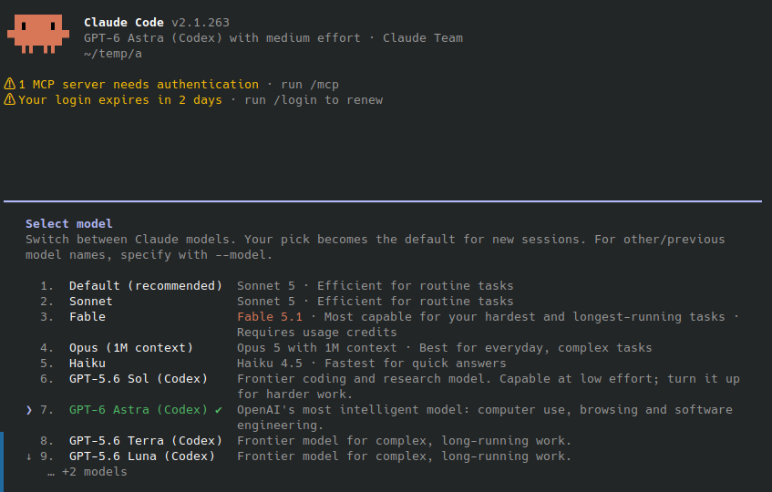

# claude-code-model-proxy (`ccmproxy`)

Adds OpenAI **Codex** models to Claude Code, paid for by your ChatGPT
subscription, and any **OpenRouter** model you name, paid for by an OpenRouter
API key. They show up in `/model` next to the Claude models, and everything
else still goes to Anthropic untouched.



Claude Code needs no `ANTHROPIC_BASE_URL` change and no settings file: the
proxy answers as `api.anthropic.com` itself, using its own local CA.

## Quick start

Point `api.anthropic.com` at the proxy with `/etc/hosts`. Six steps, Linux
shown; `sudo` is needed for three of them.

**1. Get the binary.** Download it from the
[latest release](https://github.com/jclab-joseph/claude-code-model-proxy/releases/latest),
or build it:

```sh
go build -o ccmproxy ./cmd/ccmproxy
```

**2. Sign in to ChatGPT.** Skip this if you already use the Codex CLI —
`~/.codex/auth.json` is picked up as it is.

```sh
./ccmproxy login codex
```

**3. Serve TLS on a loopback address of its own.** Any `127.x.x.x` works and
leaves `127.0.0.1:443` free for anything else.

```sh
mkdir -p ~/.config/ccmproxy
cat > ~/.config/ccmproxy/config.yaml <<'YAML'
listen_tls: 127.1.0.101:443
YAML
```

**4. Allow it to bind port 443 without running as root.**

```sh
sudo setcap cap_net_bind_service=+ep ./ccmproxy
```

**5. Trust the CA.** The certificate is created on demand and then reused, so
this is a one-time step.

```sh
./ccmproxy ca --export /tmp/ccmproxy-ca.crt
sudo cp /tmp/ccmproxy-ca.crt /usr/local/share/ca-certificates/ccmproxy-ca.crt
sudo update-ca-certificates
```

**6. Start the proxy, then redirect the hostname.**

```sh
./ccmproxy serve --experimental-modify-bootstrap-models

# in another terminal
echo '127.1.0.101 api.anthropic.com' | sudo tee -a /etc/hosts
```

Restart Claude Code and open `/model`: the Codex models are in the list.
Reasoning effort is Claude Code's own control — `/effort` or `--effort`.

To turn the whole thing off, delete that `/etc/hosts` line. Nothing else on the
machine has to change.

### Notes on those steps

- **`./run.sh`** does steps 1, 4 and 6 for you: it builds, grants the
  capability, adds the `/etc/hosts` line, starts the proxy, and takes the
  line back out when you stop it with Ctrl-C.
- **`--experimental-modify-bootstrap-models`** is what puts the models in the
  picker. It rewrites Claude Code's startup response, which is undocumented
  and can change with any release — hence the flag. The stable alternative is
  a `modelPicker` block in `settings.json`; see
  [Making the models appear in `/model`](#making-the-models-appear-in-model).
- **Trusting the CA system-wide** also makes `curl` and other tools work. If
  you would rather not touch the system store, set
  `NODE_EXTRA_CA_CERTS=~/.config/ccmproxy/ca/ca.crt` for Claude Code instead.
- **macOS** routes only `127.0.0.1` to loopback by default. Either use
  `127.0.0.1:443` in step 3, or add the alias:
  `sudo ifconfig lo0 alias 127.1.0.101`.
- The proxy resolves `api.anthropic.com` itself, over DNS, so the `/etc/hosts`
  line does not send it back to itself. See [Name resolution](#name-resolution).

## What it does

All traffic is forwarded to `api.anthropic.com` exactly as it arrives, with two
exceptions:

1. **`GET /v1/models`** — the upstream catalog is returned with the added
   models appended. Note that this endpoint does *not* drive Claude Code's
   `/model` picker; see [Making the models appear in `/model`](#making-the-models-appear-in-model).
2. **Requests naming an added model** — these are translated and sent to that
   model's own provider instead of Anthropic.

The added models come from two providers, both reached over the OpenAI
Responses API:

- OpenAI's **Codex** models, through a ChatGPT subscription over OAuth 2.0
  (authorization code + PKCE), the same way the Codex CLI does. The OAuth and
  Responses API details follow
  [CLIProxyAPI](https://github.com/router-for-me/CLIProxyAPI).
- **OpenRouter** models, with an API key; see [OpenRouter](#openrouter).

Subagents keep their own model, so a session can run its main agent on an
added model and delegate to a Claude subagent, or the other way round.

The certificates are created once and reused, so the anchor you trust keeps
working — and the CA's *private* key is never stored.

## How the interception works

```
Claude Code ──/etc/hosts──▶ TLS to api.anthropic.com:443   (quick start)
            ──HTTPS_PROXY─▶ CONNECT api.anthropic.com:443   (alternative)
                                 │
                    ┌────────────┴─────────────┐
                    │  host intercepted?       │
                    └────────────┬─────────────┘
                     yes │                │ no
                         ▼                ▼
            TLS terminated with    raw TCP tunnel,
            a leaf minted by       bytes untouched
            the local CA
                         │
                         ▼
                 ┌───────────────┐
                 │    router     │
                 └───┬───────┬───┘
        Codex model  │       │  everything else
                     ▼       ▼
        chatgpt.com/backend-api/codex   api.anthropic.com
        (Responses API, OAuth)          (verbatim pass-through)
```

Only the hosts in `intercept_hosts` are decrypted. Every other CONNECT target
is a blind byte pipe, so unrelated HTTPS traffic is never touched.

Every outbound connection is made through the proxy's own DNS resolver, so
"the upstream" always means the real upstream even when the machine's
`/etc/hosts` says otherwise. See [Name resolution](#name-resolution).

Three ways to reach the proxy, all serving the same router:

| Listener | Config key | Default | Use |
| --- | --- | --- | --- |
| Direct TLS | `listen_tls` | `127.0.0.1:8443` | a hosts-file or DNS redirect of `api.anthropic.com` — the quick start |
| CONNECT proxy | `listen_proxy` | `127.0.0.1:8080` | `HTTPS_PROXY`, for clients you would rather not redirect |
| Plain HTTP | `listen_http` | `127.0.0.1:8081` | local testing, or `ANTHROPIC_BASE_URL` if you prefer it |

**Listeners are opt-in once a configuration file exists.** Only the ones the
file names are started; a key that is absent — or empty — disables its
listener, rather than falling back to the default address. The defaults above
apply only when there is no configuration file. `ccmproxy status` shows which
listeners are on, and `serve` fails with a clear message if none are.

## Install

Download the archive for your platform from the
[latest release](https://github.com/jclab-joseph/claude-code-model-proxy/releases/latest)
and verify it against `checksums.txt`:

```sh
sha256sum -c checksums.txt --ignore-missing
tar -xzf ccmproxy_*_linux_amd64.tar.gz     # or unzip on Windows
./ccmproxy version
```

Builds are published for `linux`, `darwin` and `windows` on both `amd64` and
`arm64`. They are statically linked (`CGO_ENABLED=0`), so there is nothing to
install alongside them.

## Build from source

```sh
go build -o ccmproxy ./cmd/ccmproxy
```

Go 1.26 or newer. `ccmproxy version` reports `dev` for a plain `go build`; the
release workflow stamps the tag with `-ldflags "-X main.version=..."`.
Dependencies: `gjson`/`sjson` for JSON rewriting,
`golang.org/x/net/dns/dnsmessage` for the DNS wire format and
`go.yaml.in/yaml/v3` for the configuration file.

## Alternative: reach the proxy over `HTTPS_PROXY`

Instead of redirecting the hostname, Claude Code can be pointed at the proxy's
CONNECT listener. This needs no `sudo` and no privileged port, but it does need
the environment set for every client.

```sh
./ccmproxy serve                 # listen_proxy defaults to 127.0.0.1:8080
eval "$(./ccmproxy env)"         # HTTPS_PROXY, HTTP_PROXY, NODE_EXTRA_CA_CERTS
claude
```

To make it permanent, put the same values in `~/.claude/settings.json`:

```json
{
  "env": {
    "HTTPS_PROXY": "http://127.0.0.1:8080",
    "NODE_EXTRA_CA_CERTS": "/home/you/.config/ccmproxy/ca/ca.crt"
  }
}
```

Either way the models still need to reach the `/model` picker, with
`--experimental-modify-bootstrap-models` or a `modelPicker` block:

```sh
./ccmproxy models --settings-json > /tmp/picker.json
jq -s '.[0] * .[1]' ~/.claude/settings.json /tmp/picker.json > /tmp/merged.json
mv /tmp/merged.json ~/.claude/settings.json
```

`./ccmproxy models` lists what is on offer.

### The certificate authority

Three files are kept in `ca_dir`, created on first use and reused afterwards:

| File | Mode | What it is |
| --- | --- | --- |
| `ca.crt` | 644 | the root certificate — the anchor clients install |
| `tls.crt` | 644 | the server certificate for `intercept_hosts` |
| `tls.key` | 600 | its private key |

Both are ECDSA **P-256** and valid for **one year**. Only `tls.crt` is
presented during a handshake: a server must not send its own self-signed root,
which OpenSSL 3 — and therefore Node, and therefore Claude Code — rejects with
`SELF_SIGNED_CERT_IN_CHAIN`. Restarting the proxy reloads
these files unchanged, so `NODE_EXTRA_CA_CERTS` stays valid and Claude Code
does not have to be re-pointed at anything.

**The root's private key is deliberately not among them.** It is generated in
memory, signs `ca.crt` and `tls.crt` once, and is discarded before the proxy
serves a single request. Storing it is what would make this dangerous: a
leaked CA key impersonates *any* site to a client that trusts the anchor,
whereas a leaked `tls.key` impersonates exactly the hosts already named in
`tls.crt` — the ones the proxy is intercepting anyway.

The price of not keeping the root key is that nothing can be signed later, so
new material — and therefore a new anchor clients must trust — is created when:

- the certificates are within 30 days of expiry,
- a host is **added** to `intercept_hosts` (removing one changes nothing), or
- any of the three files is missing, unreadable, or does not match the others.

`serve` says so explicitly when it happens:

```
WRN a new certificate authority was created (no certificate authority stored yet)
WRN clients must trust the new .../ca/ca.crt; restart Claude Code so it re-reads NODE_EXTRA_CA_CERTS
```

Otherwise it just reports the expiry, and `ccmproxy status` shows it too.

`ccmproxy ca` prints the certificate, creating it if it does not exist yet;
because the material is stable this is safe to run alongside a live proxy.
Export a copy for clients that ignore `NODE_EXTRA_CA_CERTS`:

```sh
./ccmproxy ca --export /tmp/ccmproxy-ca.crt   # prints the install command for your OS
```

## Name resolution

The proxy resolves upstream hostnames itself, over UDP (falling back to TCP for
truncated answers), with a TTL cache.

This is not a detail: in the hosts-file deployment, `api.anthropic.com` is
pointed at the proxy's own TLS listener. If the proxy then used the system
resolver to reach the real API it would resolve its own address and loop
forever. Querying nameservers directly bypasses `/etc/hosts`, `nsswitch` and
any local stub that honours them.

- **Nameservers** come from `dns.servers`, else from `/etc/resolv.conf`
  *excluding loopback addresses* — a local stub such as systemd-resolved
  (127.0.0.53) or dnsmasq reads `/etc/hosts` itself, which would defeat the
  point — else `1.1.1.1` and `8.8.8.8`.
- **`dns.static`** pins a name to addresses without any query.
- **The proxy's own listeners are refused.** If an upstream name resolves to
  one, the request fails with an explicit message instead of hanging.

Check what the proxy sees with:

```sh
./ccmproxy dns api.anthropic.com chatgpt.com
```

Setting `dns.enabled` to `false` falls back to the operating system resolver,
which is only safe when nothing redirects the intercepted hosts.

## Making the models appear in `/model`

Claude Code's `/model` picker is **not** built from `GET /v1/models`. Verified
against Claude Code 2.1.263 by logging every request of a full session: that
endpoint is fetched zero times. The picker is Claude Code's own model catalog
plus two lists it is given:

- `additional_model_options` in the `GET /api/claude_cli/bootstrap` response —
  this is how Anthropic itself adds a model (that is where the `Fable` row
  comes from), and
- `modelPicker.options` in `settings.json`.

There *is* a `/v1/models` discovery path in the binary, but it cannot work
here, for two independent reasons:

```js
// it only runs when the base URL points somewhere that is NOT the real API
function Qv(){ let e=process.env.ANTHROPIC_BASE_URL; if(!e) return true; return Gw(e) }
function Gw(e){ return ["api.anthropic.com"].includes(new URL(e).host) }
function Dp(){ …; if(po()) return false; if(!a.ANTHROPIC_BASE_URL) return false; … }

// and it drops every id that is not Anthropic's
.filter((c) => /(claude|anthropic)/i.test(c.id))
```

The first condition is the opposite of what this proxy does — it keeps
`api.anthropic.com` and intercepts it — and the second would discard `gpt-5.5`
anyway. So the model list is still merged for correctness and for other
clients (`curl`, the SDKs), but it is not what makes the picker work.

### Option 1: `modelPicker` in settings.json (stable)

```sh
./ccmproxy models --settings-json
```

emits a ready-to-merge block:

```json
{
  "modelPicker": {
    "options": [
      {
        "model": "gpt-5.6-sol",
        "label": "GPT-5.6 Sol (Codex)",
        "description": "Frontier coding and research model. …",
        "behavesAs": "claude-opus-5"
      }
    ]
  }
}
```

`behavesAs` is required, not decoration: it names a model the installed Claude
Code knows, whose client-side handling — prompt profile, capability and effort
defaults — is applied. Without it, *a row for a model this version does not
know is not offered at all*, and selecting the model prints

```
"gpt-5.5" isn't described by this version's model catalog …
```

The model id sent upstream is unchanged; only the client's own assumptions
come from `behavesAs`. Add `"replaceBuiltInOptions": true` to show *only* these
rows, and see `./ccmproxy models` for the mapping each model uses.

The context window Claude Code assumes comes from `behavesAs` too, so a model
with a larger one is compacted earlier than it needs to be. Either append
`[1m]` to the model name (the proxy strips the suffix before routing) or set
`CLAUDE_CODE_MAX_CONTEXT_TOKENS` to the real window.

### Option 2: `--experimental-modify-bootstrap-models` (no client configuration)

```sh
./ccmproxy serve --experimental-modify-bootstrap-models
```

The proxy then adds its models to the two responses Claude Code builds the
picker from, so they show up with **no client-side configuration at all** —
which is what makes it worth having when handing the proxy to a teammate:

- `/api/claude_cli/bootstrap` — appended to `additional_model_options`.
- `/api/organizations/<org>/model_selector/cc` — appended as rows of the `cc`
  model catalog. Once an account is served this catalog, Claude Code builds
  the picker from it alone and ignores the bootstrap list, so this is the one
  that matters on current versions. Each row carries a
  `min_claude_code_version` (without one, Claude Code only offers models it
  already knows), the model's `behaves_as`, its context window and its effort
  levels.

Claude Code caches the catalog for about an hour, so models added or changed
while it is cached appear only once it refreshes. To see them at once, delete
the cached file and restart Claude Code:

```sh
rm ~/.claude/cache/model-catalog/*-cc.json   # under $CLAUDE_CONFIG_DIR if set
```

It is experimental and off by default because it rewrites an undocumented
Claude Code response rather than a published Anthropic API one, and the shape
can change with any release. The implementation is deliberately timid: a
response that is still compressed, is not JSON, carries an unexpected
`additional_model_options` or `model_selector_config` shape, or came back
non-2xx is forwarded untouched, and a model the account already offers is
never duplicated. A broken bootstrap
response would take out much more than the model picker.

**The two options are complementary, and using both is the best setup.**
Bootstrap injection supplies the rows but does not make Claude Code *know* the
models, so on its own it still prints the model-catalog warning and assumes a
200k window. `behavesAs` is what clears that. With both in place:

```
$ claude --model gpt-5.6-sol-high -p "Reply with just your model name."
gpt-5.6-sol-high
# proxy: bootstrap: added 28 models to the /model picker
# proxy: codex messages model=gpt-5.6-sol-high -> gpt-5.6-sol effort=high
```

## Model names and effort

Every model is accepted under several spellings:

| Name | Meaning |
| --- | --- |
| `gpt-5.5` | the model, with the effort the client asks for |
| `gpt-5.5-high` | pins the effort to `high`, overriding the client |
| `gpt-5.5:high` | the same, colon separated |
| `codex/gpt-5.5-high` | with a namespace prefix |
| `gpt-5.5[1m]` | Claude Code's context-window suffix, ignored |

**Reasoning effort is Claude Code's own control, not a model name.** `/effort`
and `--effort` send the choice with the request as `output_config.effort`, and
the proxy maps it onto the Codex `reasoning.effort`, so one picker row per
model is enough:

```
--effort high   →  output_config.effort=high   →  reasoning.effort=high
--effort low    →  output_config.effort=low    →  reasoning.effort=low
(unset)         →  output_config.effort=medium →  reasoning.effort=medium
```

Claude Code remembers the last effort you chose, so a run with no `--effort`
still sends one; the proxy forwards whatever arrives rather than second
guessing it. Token counting ignores effort, since it does not affect the
prompt.

Claude Code offers the effort levels of the model a picker row *behaves as*,
which can exceed the real model's range, so the value is clamped: `max` on
`gpt-5.5` (which stops at `xhigh`) becomes `xhigh`, and Claude Code's `ultra`
becomes the highest level the model has.

A name that pins the effort still works and wins over the client's choice.
Those per-effort ids are **not** advertised by default — they would multiply
the picker rows for something Claude Code already controls. Set
`codex.effort_variants` to `true` to list them, which is worth doing for a
client that has no effort control of its own.

Set `codex.models` to a list to restrict the catalog.

## Credentials

Codex credentials are looked for in this order, and the **first file that
exists wins**:

| Order | File | Written by |
| --- | --- | --- |
| 1 | `codex.auth_file`, if configured | either tool, layout detected |
| 2 | `~/.config/ccmproxy/auth/codex.json` | `ccmproxy login codex` |
| 3 | `~/.codex/auth.json` | the Codex CLI (`CODEX_HOME` is honoured) |

An existing Codex CLI login therefore works with no setup. Both layouts are
understood, including the CLI's, which nests the tokens under `tokens` and
records no expiry — that is read from the access token's own `exp` claim, along
with the account id and plan.

A **refreshed token is written back to the file it came from**, in that file's
own layout and preserving the fields this proxy does not own (`auth_mode`,
`OPENAI_API_KEY`, anything added later). So borrowing the CLI's login keeps the
CLI working rather than quietly invalidating it. For the same reason, a file
that changes underneath the proxy is re-read rather than served from cache: if
the Codex CLI refreshes on its own, its rotated refresh token is picked up
instead of being overwritten with a stale one.

`ccmproxy login codex` always writes this proxy's own file and never touches
`~/.codex/auth.json`; `ccmproxy logout codex` likewise removes only its own.
Set `codex.use_codex_cli_auth` to `false` to ignore the CLI's file entirely.

## OpenRouter

Name the models to add under `openrouter.models` and put the API key in
`OPENROUTER_API_KEY`. The provider is off while the list is empty.

```yaml
openrouter:
  # api_key_env: OPENROUTER_API_KEY   # the variable the key is read from
  # model_prefix: ""                  # openrouter/ is accepted regardless
  # provider:                         # OpenRouter provider routing, sent as is
  #   sort: price
  models:
    - id: z-ai/glm-5.3-flash
      # behaves_as: claude-sonnet-5   # the Claude model Claude Code treats it as
      # display_name, description, default_effort
```

Select it with `/model z-ai/glm-5.3-flash` (or `openrouter/z-ai/glm-5.3-flash`).

- **Data collection is always denied.** Every request carries
  `provider.data_collection: deny`, so OpenRouter only routes to providers that
  do not retain or train on prompts. It is set after the configured
  preferences, and a configuration asking for anything else is refused at
  startup.
- **Only the key goes to OpenRouter.** The request is built from scratch with
  the OpenRouter key, so Claude Code's Anthropic credentials never leave for
  OpenRouter.
- **Model details come from OpenRouter.** The context window, output limit,
  image input and reasoning support are read from OpenRouter's public model
  list at startup. Without it the configured models are still offered, with
  conservative defaults, and a warning names a model OpenRouter does not list
  or that cannot call tools — Claude Code cannot work without them.
- **Reasoning** streams back as thinking blocks and is replayed to OpenRouter
  as reasoning text on the next turn. It is marked as OpenRouter's, so it is
  never sent to Anthropic or Codex after a model switch.

## Commands

```
ccmproxy serve                run the proxy (default command)
  --experimental-modify-bootstrap-models
                              also add the models to Claude Code's startup
                              response, so /model lists them with no
                              settings.json change
ccmproxy login codex          sign in to a ChatGPT account
ccmproxy logout codex         remove the stored credentials
ccmproxy status               configuration, CA path and login state
ccmproxy models               the models this proxy adds
ccmproxy models --settings-json   a modelPicker block for settings.json
ccmproxy ca [--export path]   print or export the CA certificate
ccmproxy env [--shell fish]   the environment Claude Code needs
ccmproxy dns HOST...          resolve names with the internal resolver
ccmproxy config init          write a config file with the current defaults
```

Two endpoints are served on the intercepted host itself:
`GET /__ccmproxy/status` and `GET /__ccmproxy/ca`.

## Configuration

`~/.config/ccmproxy/config.yaml` (override with `--config`, or relocate the
whole directory with `CCMPROXY_HOME` / `XDG_CONFIG_HOME`). YAML is the primary
format; JSON is still read, so an existing `config.json` keeps working. With no
`--config`, the first of `config.yaml`, `config.yml` and `config.json` found in
that directory is used. The format follows the extension: `.json` is JSON,
anything else is YAML, and the keys are the same in both.

A leading `~` is
expanded in every path setting — `ca_dir`, `auth_dir`, `codex.auth_file`,
`--config` and `ca --export` — since a value read from a file never passes
through a shell. `~otheruser` is not expanded. Every field is
optional and unset fields take the value below — except the three `listen_*`
keys, which turn a listener **on**: omit one and that listener does not start.
`ccmproxy config init` writes this file with every field filled in, which is
the easiest starting point.

```yaml
listen_proxy: 127.0.0.1:8080
listen_tls: 127.0.0.1:8443
listen_http: 127.0.0.1:8081
upstream: https://api.anthropic.com
intercept_hosts:
  - api.anthropic.com
proxy_username: ""
proxy_password: ""
ca_dir: ~/.config/ccmproxy/ca
auth_dir: ~/.config/ccmproxy/auth
log_level: info
codex:
  base_url: https://chatgpt.com/backend-api/codex
  user_agent: codex-tui/...
  originator: codex-tui
  models: []
  effort_variants: false
  model_prefix: ""
  callback_port: 1455
  auth_file: ""
  use_codex_cli_auth: true
openrouter:
  base_url: https://openrouter.ai/api/v1
  api_key_env: OPENROUTER_API_KEY
  provider: {}          # data_collection is always deny
  models: []            # see OpenRouter
dns:
  enabled: true
  servers: []
  timeout_ms: 5000
  static: {}
  min_ttl_seconds: 30
  max_ttl_seconds: 3600
```

Setting both `proxy_username` and `proxy_password` requires Basic credentials
on the CONNECT proxy. The listeners bind to loopback by default — anything
that can reach the proxy can have its `api.anthropic.com` traffic decrypted, so
keep it that way unless you also set credentials.

Individual listeners can also be disabled for one run with
`--no-proxy-listener`, `--no-tls-listener` and `--no-http-listener`.

## What the translation covers

Anthropic Messages ⇄ OpenAI Responses, in both directions:

- **System prompt** → a `developer` input message.
- **Text, images and PDFs** → `input_text` / `input_image` / `input_file`.
  Non-PDF documents are dropped, which is all the Responses API accepts.
- **Tools** → `function` tools; `input_schema` is normalized (`$schema`
  removed, `properties` filled in). Names over 64 characters are shortened
  uniquely — MCP tools keep their leaf name — and mapped back on the way out,
  so the client always sees the name it registered.
- **Tool calls and results** → `function_call` / `function_call_output`, with
  ids shortened by hash when they exceed the upstream limit.
- **Thinking** → reasoning summaries stream back as `thinking` blocks, and each
  block carries the encrypted reasoning state as its signature so the next turn
  can replay it. Parallel tool calls are serialized into non-overlapping
  content blocks, which is what the Messages API requires.
- **Reasoning effort** ← the model name suffix, otherwise derived from
  `thinking.budget_tokens`.
- **Usage** → `input_tokens` / `output_tokens`, with cached tokens reported
  separately as `cache_read_input_tokens`.

Non-streaming requests go through the same translator and are then folded back
into one message, since the Codex backend only serves streaming responses and
does not repeat the output items in its terminal event.

### Compressed request bodies

Claude Code gzips request bodies once they grow past a threshold, so most real
sessions arrive as `Content-Encoding: gzip`. The router decodes the body to
read the model name — otherwise every large request would look like one for an
unknown model and be sent to Anthropic regardless of what was selected.

Pass-through still forwards the **original compressed bytes** and the client's
`Content-Encoding` untouched; only a body the proxy has to rewrite is sent
decoded, with the coding header dropped. `gzip` and `deflate` are decoded;
anything else (a request under `br` or `zstd`, or a corrupt stream) is
forwarded untouched with a warning, since a request that cannot be inspected
can still be proxied.

### Two deliberate deviations from byte-exact pass-through

- **`/v1/messages/count_tokens` for an added model** is answered locally with a
  length-based estimate. The Codex backend exposes no counting endpoint and its
  tokenizer is not public, so the estimate is deliberately conservative —
  Claude Code uses this number to decide when to compact a conversation.
- **Thinking blocks this proxy issued are stripped** from requests that go to
  Anthropic. Codex reasoning state is not a valid Anthropic signature, so a
  session that switched from a Codex model back to a Claude model would
  otherwise be rejected upstream. Requests that never touched a Codex model are
  detected by a byte scan and pass through unmodified.

## Tests

```sh
go test ./...
```

The suite runs the whole path without network access:

- TLS interception through a real CONNECT proxy, and the direct TLS listener.
- That the CA directory never holds a root private key, that a key left
  behind by an earlier version is removed, that stored material is reused
  across restarts, and that the served chain omits the self-signed root.
- Model-list merging and byte-for-byte pass-through fidelity.
- The streaming translation state machine, including parallel tool calls.
- OAuth exchange and refresh against a fake token endpoint, reading a Codex
  CLI `auth.json`, and writing a refreshed token back into it without
  disturbing the fields the CLI owns.
- The resolver against a DNS server the test starts itself: UDP, the TCP
  retry on truncation, TTL caching, server failover, and the refusal to dial
  the proxy's own listener.
- Effort handling: that the client's `output_config.effort` reaches the Codex
  backend, that it is clamped to the levels the real model has, and that an
  effort pinned in the model name overrides it.
- Compressed request bodies: that a gzipped or deflated request for an added
  model is routed to it, that pass-through keeps the original bytes and
  coding, that a rewritten body drops the coding, and that an undecodable or
  corrupt body is forwarded byte for byte.
- Bootstrap rewriting against a copy of the real response: that the account's
  own entries survive and are never duplicated, that every field the client's
  schema requires is present, that a null or absent option list is handled,
  and that a compressed, non-JSON, misshapen or failed response is forwarded
  byte for byte instead.
- OpenRouter against a fake endpoint: that only the OpenRouter key is sent,
  that `data_collection` is `deny` whatever the configuration says, and that
  each provider replays only its own reasoning.

### End-to-end tests

`e2e/` drives the real Claude Code CLI through a freshly built proxy, against
the real upstreams. It costs money and needs a signed-in Claude Code, so it
only builds with a tag:

```sh
go test -tags e2e -v -timeout 60m ./e2e
```

Each scenario runs for every main model (`CCM_E2E_MODELS`, default
`z-ai/glm-5.3-flash,gpt-5.5`); a model whose provider has no credentials is
skipped. `OPENROUTER_API_KEY` is read from the environment or the repository's
`.env`.

| Scenario | What it catches |
| --- | --- |
| `Reply` | the basic round trip, and the model name the client sees |
| `FixWithTools` | Read, Edit and Bash across several turns |
| `ParallelReads` | parallel tool results attached to the wrong call |
| `Subagent` | a general-purpose subagent on the same provider |
| `SubagentOnClaude` | the main agent on the added model, a subagent on Claude (`CCM_E2E_SUBAGENT_MODEL`, default `opus`) |
| `SwitchFromClaude` | Claude → added model → Claude in one session, where Claude Code's message-thread continues drop the tools |
| `Compact` | `/compact` on the added model |

Set `CCM_E2E_KEEP=1` to keep the work directory: every turn's stream-json
transcript and the proxy's debug log are there, and a failure names both.


## Security notes

- **The CA private key is never stored.** It exists only in memory, signs the
  two certificates once, and is overwritten before `serve` starts listening.
  The overwrite is best effort — `big.Int` arithmetic may have left copies that
  Go's runtime does not promise to scrub — but that the key never reaches disk,
  and cannot sign anything afterwards, is guaranteed.
- `tls.key` *is* stored, at mode 600; a stable server certificate needs it.
  Its blast radius is limited to the hosts in `tls.crt`, and nothing can be
  issued beyond them because there is no CA key left to issue with.
- Credential files are written with mode `600`, the CA directory with `700`.
- Upstream connections ignore the ambient proxy environment variables and use
  the internal resolver, so the proxy can neither be pointed at itself nor be
  redirected by a hosts file. A resolved address matching one of its own
  listeners is refused outright.
- The listeners bind to loopback by default, and only the ones a
  configuration file names are opened at all. Anything that can reach the
  proxy can have its `api.anthropic.com` traffic decrypted, so keep it on
  loopback unless you also set `proxy_username` and `proxy_password`.
- ID and access tokens are read for the account id, plan and expiry only; their
  signatures are not verified, because they arrive over TLS directly from the
  issuer's token endpoint and are never trusted as proof of anything.
